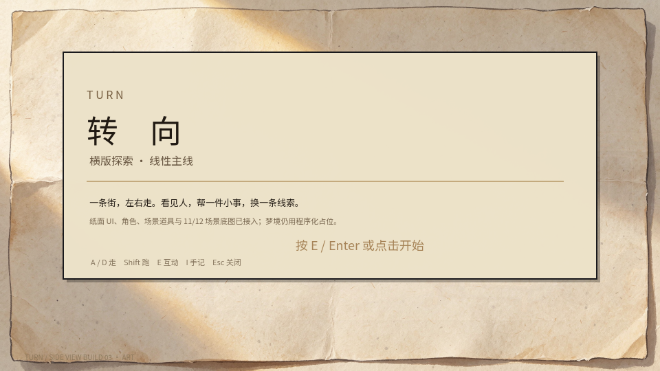
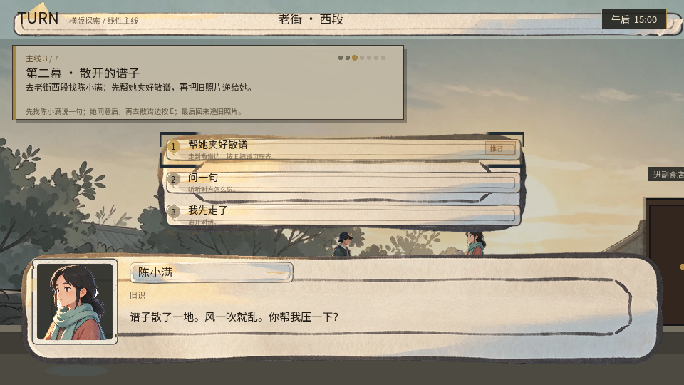
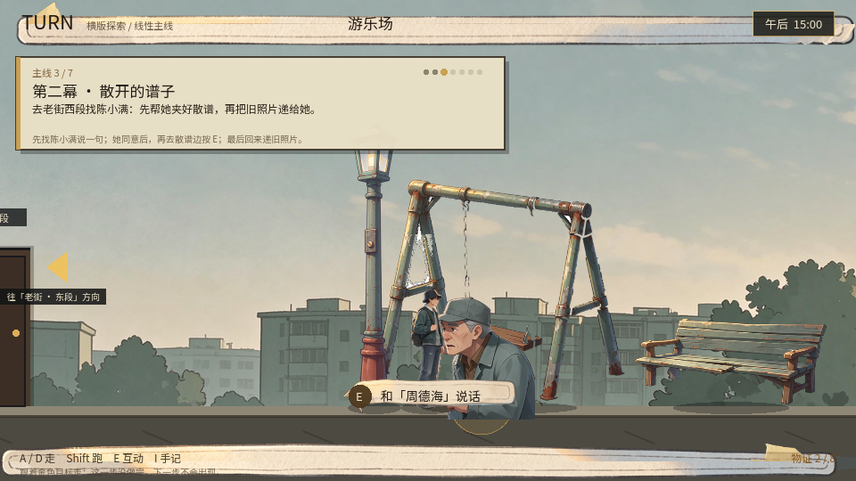
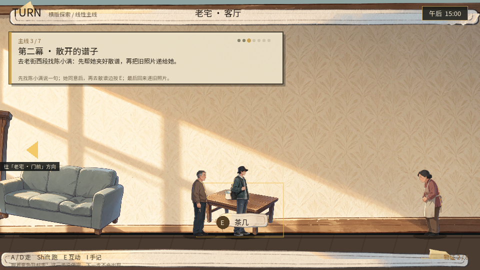

# Turn / TurnSide

《转向》的横版侧视线性重构版（v3 美术接入）。Godot **4.7.2**，960×540，入口 `main.tscn`。

## 这一版是什么

- 七步线性主线：车站 → 镇口 → 老街西段 → 老宅门前/客厅 → 老街东段 → 游乐场 → 搬家路口 → 地下室/梦境 → 终章。
- 正式 UI：HUD 纸带、对话框、名牌、头像框、选项行、toast、prompt、标题/结局底图、金色选中框、8 张物证图标。
- 正式角色：NPC 的 idle/talk 帧、玩家沈砚 idle 帧、按方向镜像、脚下影子与高亮圈；7 张 512×512 头像。
- 场景道具：PR-01～PR-43 按游戏坐标接入，秋千、散谱/夹谱、琴箱开合等状态变体齐全；缺资源时回退到程序化占位。
- 场景远景：车站、镇口、老街西段、老街东段、游乐场、搬家路口、镇口灯火、老宅门前、客厅、地下室、副食店共 11 个场景使用 `P0_far` 正式远景；`dream` 仍为程序化占位。
- 对话/物证/手记打开时叠加 18% 暗幕，保证明亮天空下文字与纸片可读。

## 运行

用 Godot 4.7.2 打开本目录，等待首次资源导入完成后运行 `main.tscn`。首次导入会生成 `.godot/`，该目录已被忽略。

命令行验证：

```powershell
# 首次导入（生成 .godot 缓存）
godot --headless --editor --quit --path .

# 七步主线自动测试，期望 FLOW DONE checks=0
godot --headless --path . res://tests/flow_linear.tscn

# 960×540 实机截图测试，输出 9 张 PNG
godot --path . --resolution 960x540 res://tests/art_sample.tscn
```

## 美术资源说明

仓库只收录运行时实际使用的 `art/scenes/<scene_id>/<scene_id>_P0_far.png`，以及角色、UI、道具、物证、字体等资源。P1/P2/P3 分层源图未纳入 Git，以免仓库体积失控；当前版本通过整体 tint 近似傍晚、入夜、临走色调。需要继续叠层时，请使用本地完整分层源包。

## 目录

```text
art/        UI、角色、道具、物证、场景 P0_far
data/       剧情与手记数据
fonts/      字体
scripts/    横版场景、角色、UI、道具、世界状态逻辑
tests/      主线流程与美术截图测试
docs/       v3 验收文档与 9 张实机截图
main.tscn   入口场景
```

## 截图

| 标题 | 对话与纸面 UI |
| --- | --- |
|  |  |

| 游乐场 | 客厅 |
| --- | --- |
|  |  |

更多截图见 [`docs/screenshots`](docs/screenshots)，验收细节见 [`docs/TurnSide_v3_验收.md`](docs/TurnSide_v3_验收.md)。
