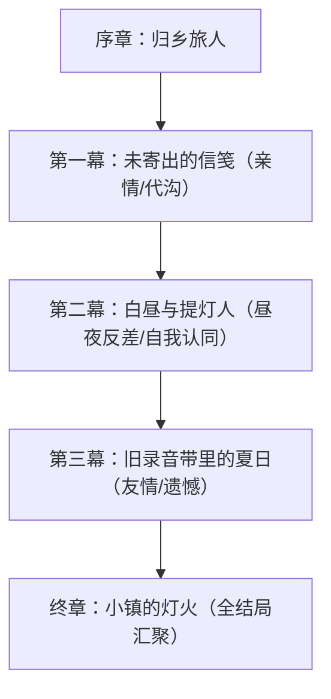
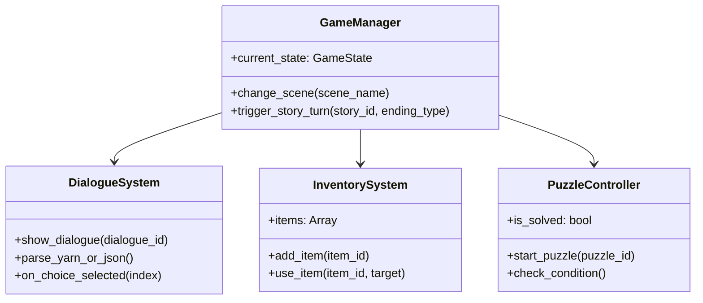
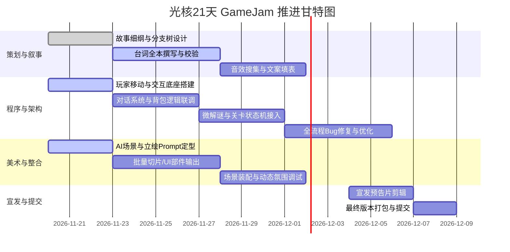

# 《Turn（转变）》光核 21 天 GameJam 策划与开发协作文档 (GDD)

> **项目名称**：暂定《回响之隙 / 转身之后》（英文暂定：Echo of Turns）  
> **比赛主题**：Turn（转变 / 翻转 / 视角转换）  
> **开发周期**：21 天（当前已进入第 2 天）  
> **开发引擎**：Godot Engine (2D)  
> **视觉基调**：治愈系国漫风（参考《时光代理人》色调与氛围感，AI 工具链统一把控）  
> **核心类型**：2D 45度俯视角叙事探索 + 视角/信息转换微解谜  
> **协作说明**：本文档为团队公共设计文档，各模块负责人可直接补充与修改对应章节。

---

## 目录
1. [项目立项与核心框架提炼](#一项目立项与核心框架提炼)
2. [会议结论精要与历史沉淀](#二会议讨论要点与决策复盘)
3. [团队成员与职责分工矩阵 (RACI)](#三团队成员与分工矩阵)
4. [核心游戏机制与单关循环 (Gameplay Loop)](#四核心机制与关卡闭环设计)
5. [剧情叙事框架与 3~4 个故事原型](#五叙事框架与故事蓝图)
6. [美术管线与 AI 落地规范](#六美术与音频管线规范)
7. [技术架构与 Godot 模块划分](#七技术架构与程序模块划分)
8. [21 天敏捷排期与里程碑规划](#八21-天敏捷推进时间表)
9. [待确认议题与风险应对](#九待决策议题与风险防范)

---

## 一、项目立项与核心框架提炼

### 1.1 主题“Turn（转变）”的三层解读
在本次立项中，我们将“Turn”进行了自内而外的递进设计，避免单一表层的转动或简单时钟倒流：
```
           ┌──────────────────────────────────────────────┐
           │  【表层机制】：视角转换 (Perspective Turn)     │
           │   玩家观察冲突双方信息差，昼夜/正反双视角调查   │
           └──────────────────────┬───────────────────────┘
                                  ▼
           ┌──────────────────────────────────────────────┐
           │  【中层玩法】：因果扭转 (Causality Turn)       │
           │   通过特定道具/媒介揭示隐藏真相，解开NPC心结    │
           └──────────────────────┬───────────────────────┘
                                  ▼
           ┌──────────────────────────────────────────────┐
           │  【内核表达】：心态转变 (Mindset Turn)         │
           │   从固执与偏见走向换位共情，NPC自发达成和解    │
           └──────────────────────────────────────────────┘
```

### 1.2 游戏核心定位
* **操作维度**：主角以“小镇原住民回归”的旁观者/介入者视角，在 2D 45度俯视角小镇场景中自由移动、对话、调查场景交互物。
* **玩法定位**：
  * **非传统战斗**：坚决剔除高成本打击动作，规避动作帧与打击感短板。
  * **轻量解谜驱动叙事**：在探索过程中穿插小型环境/信息解谜（如寻找关键物件、光路/视线连接、日记拼凑），打破纯播片纯读字带来的枯燥。
  * **玩家定位**：不是替 NPC 做决定的“替身操纵者”，而是**“情感桥梁与真相揭示者”**。玩家通过道具媒介还原双方不敢言说的真实想法，促使 NPC 自发转变，引导走向不同结局。

---

## 二、会议讨论要点与决策复盘

### 2.1 方案演进脉络
* **第 1 场会议（头脑风暴与技能盘点）**：
  * 提出 5 种方向（双时间线反战、青年异空间探索、几何视角解谜、陀螺/丧尸转变、体验他人人生）。
  * 敲定采用 AI 工具辅助美术生产，确立 Godot 引擎方向与队长全流程把控策略。
* **第 2 场会议（玩法收敛与风格确立）**：
  * 明确放弃 3D 与动作战斗，定调为 2D 俯视角探索。
  * 保留“昼夜身份反差/双面性格”作为局部增色机制。
  * 拍板“多结局”与“小体量精品化”原则（任务量严格压制在 3~4 个，防止烂尾）。
* **第 3 场会议（核心机制博弈与收敛）**：
  * **分歧焦点**：“直接附身 NPC” vs “梦境微操” vs “关键道具解谜揭示真相”。
  * **最终结论**：
    1. 放弃生硬的“替身附身”，NPC 行为需要自驱力与情感自洽。
    2. 采用**“关键物件/道具作为催化剂”**，将“强行改变现实”转化为**“揭开被掩盖的真心与细节”**。
    3. 美术基调从像素风转向**《时光代理人》式国漫治愈系**插画与场景。

---

## 三、团队成员与分工矩阵

| 成员 ID / 称呼 | 专业背景 | 团队主定位 | 详细承接任务 | 协作对接人 |
| :--- | :--- | :--- | :--- | :--- |
| **李哲文（土豆/队长）** | 物联网工程 | **制作人 / 美术主管** | 1. 整体节奏控盘与里程碑把控<br>2. AI 画面 Prompt 与治愈国漫风统一<br>3. 场景切片、UI 风格把控与 Godot 底层支持 | 全体成员 |
| **碎碎** | 新闻与传播 | **主叙事 / 文案总监** | 1. 主线剧本与 3~4 个支线冲突台词主笔<br>2. 情感走向与角色台词人设立体度把控<br>3. 收集/配置背景音乐与环境音效 | 唯一、游戏小王 |
| **唯一** | 策划与剪辑 | **系统/关卡策划 / 宣发** | 1. 关卡交互逻辑设计、解谜规则拆解<br>2. 叙事向分支树状态表制作<br>3. 游戏宣传片、预告片剪辑 | 碎碎、SASUKE |
| **SASUKE（冰淇淋魔王）** | 人工智能 | **核心程序 (Gameplay)** | 1. 玩家 2D 移动与控制器交互<br>2. 场景物体触发、背包/道具拾取与使用逻辑<br>3. 解谜小游戏机制编写 | 阿野、李哲文 |
| **观众（一叶/阿野）** | 计算机 | **核心程序 / 版本管理** | 1. 对话系统（支持多分支与头像情绪变化）<br>2. 任务状态机与多结局存档系统<br>3. GitHub 仓库规范与分支协同管理 | SASUKE、李哲文 |
| **游戏小王（momo）** | 数字媒体技术 | **关卡交互策划 / 文案协同**| 1. 微解谜关卡设计与白盒原型搭建<br>2. 协助碎碎完成部分 NPC 背景文献/信件文案<br>3. AI 提示词测试与资源整理 | 唯一、碎碎 |

---

## 四、核心机制与关卡闭环设计

### 4.1 单个故事的玩法四步闭环 (The 4-Step Turn Loop)
```
  [1. 触发冲突]                [2. 双向调查]                 [3. 道具/解谜介入]               [4. 抉择与转变]
┌──────────────────┐        ┌──────────────────┐        ┌──────────────────────┐        ┌──────────────────┐
│  撞见戏剧性矛盾   │ ───►   │  分别与双方交流   │ ───►   │  获取关键信物/道具    │ ───►   │  呈现关键证据/真相│
│ (如母子争吵摔门) │        │ (收集单边信息差) │        │ (完成轻度场景解谜)   │        │ (触发分支结局Turn)│
└──────────────────┘        └──────────────────┘        └──────────────────────┘        └──────────────────┘
```

1. **Phase 1: 冲突呈现 (Exposition)**
   * 玩家在小镇漫步，目睹一起激烈矛盾（如：父亲指责儿子不务正业，儿子愤而离家出走；或独居老人与邻里的纠纷）。
2. **Phase 2: 双向调查 (Dual-Side Investigation)**
   * 玩家与当事人 A 对话，听到一套说辞；与当事人 B 对话，听到完全相反的委屈。
   * 发现矛盾的核心在于**“无法言说的隐衷”**与**“被误解的细节”**。
3. **Phase 3: 媒介获取与微解谜 (Puzzle & Medium)**
   * 玩家通过场景线索寻找关键媒介（例如：母亲藏在旧铁盒里的病历、写满鼓励却没寄出的草稿信、坏掉的收音机）。
   * 穿插 1~2 分钟的轻量解谜（如对齐破损信件碎片、转动钟表齿轮、连通回忆光路）。
4. **Phase 4: 介入与结局转变 (Turn Result)**
   * 玩家将解开的真相道具展示给关键角色，或者引导双方回到特定场景。
   * 结局产生分支（好结局：解开心结拥抱和解；留白结局：未能完全挽回但达成理解与释怀）。

---

## 五、叙事框架与故事蓝图

> **体量原则**：GameJam 严禁画大饼，全篇设计为 **1 个新手序章 + 3 个独立叙事单元**。



### 故事原型设定参考
* **序章：归乡旅人**
  * 玩家返回熟悉又陌生的小镇老宅，熟悉操作、移动、交互、物品栏与对话系统。
* **故事 1：未寄出的信笺（家庭与理解）**
  * **冲突**：高压严厉的单亲父亲 vs 想要离开小镇搞音乐的女儿。
  * **真相**：父亲不是反对音乐，而是曾在年轻时因同样梦想受挫并留下愧疚；吉他箱里一直留着父亲偷偷调好的琴弦与存折。
  * **解谜**：拼合被撕碎的演艺参赛报名表与老照片。
* **故事 2：白昼与提灯人（昼夜身份与善意）**
  * **冲突**：白天孤僻古怪、被小镇孩子惧怕的拾荒大爷，夜晚却在默默修补小镇的路灯与破损秋千。
  * **真相**：大爷曾经是老电工，正在用自己的方式默默守护已故孙女玩耍过的游乐场。
  * **解谜**：利用镜面转动折射光芒，点亮断电的老街路灯。
* **故事 3：旧录音带里的夏日（遗憾与告别）**
  * **冲突**：多年未联系的两位老朋友，因误会老死不相往来，其中一人即将搬迁远行。
  * **真相**：当年的误会只是一次未曾听到的留言与一场大雨。
  * **解谜**：修复老式磁带机，倒带（Turn）找到被覆盖的那句告别留言。

---

## 六、美术与音频管线规范

### 6.1 美术风格基调
* **参考标杆**：《时光代理人》动画场景插画、《Summer Pockets》局部色调。
* **画风关键词**：清透、微光漫反射、治愈系手绘国漫质感、低饱和但高明度。
* **AI 生产工作流（李哲文统筹）**：
  1. **Prompt 规范化**：队长制定统一的风格修饰词模板（如 `Makoto Shinkai lighting, Chinese modern anime style, soft watercolor edges, high resolution, cozy town`）。
  2. **角色立绘/头像**：每个主要 NPC 产出 3 种表情切片（平静、痛苦/争执、释怀/微笑）。
  3. **场景切片**：AI 生成 45 度俯视角建筑与物件，切图后导入 Godot TileSet / Sprite2D。

### 6.2 音频方案
* **背景音乐 (BGM)**：
  * 日常探索：轻柔木吉他 / 钢琴轮指，带有小镇悠闲感。
  * 冲突阶段：节奏骤紧的弦乐或空灵环境垫乐。
  * 和解/转变时刻：清澈的高音钢琴与微风音效。
* **音效 (SFX)**：
  * 脚步声（石子路/木地板）、纸张翻动声、物体交互“叮”声、回忆转场的倒带声音效。

---

## 七、技术架构与程序模块划分



### 7.1 程序责任田切分
1. **SASUKE 模块**：
   * `PlayerController`（Top-Down 8方向移动、碰撞体、移动动画切换）。
   * `Interactable` 基类（靠近高亮提示、按 E 触发对话/调查）。
   * `MiniPuzzle`（解谜弹窗基类，支持鼠标拖拽拼接或旋转交互）。
2. **阿野（观众）模块**：
   * `DialogueUI`（多行文本打字机效果、头像立绘显示、选项分支面板）。
   * `QuestManager`（负责任务阶段驱动，如 `STATE_ARGUE -> STATE_SEARCH -> STATE_SOLVED`）。
   * Git 规范维护与分支合并（主分支 `main`，特性分支 `feature-dialogue`, `feature-player`）。
3. **队长李哲文**：
   * Tilemap 关卡搭建、光照环境配置 (CanvasModulate / PointLight2D 昼夜效果)、项目总合成。

---

## 八、21 天敏捷推进时间表



### 里程碑节点
* **M1 (Day 1 - Day 4) 白盒跑通日**：
  * 产出：火柴人/方块小人可以在 2D 地图移动，按下 E 能够弹出对话框并拾取一件道具。剧本大纲定稿。
* **M2 (Day 5 - Day 11) 核心内容填充日**：
  * 产出：故事 1 与故事 2 完整流程可玩，AI 国漫风贴图替换白盒，解谜交互可用。
* **M3 (Day 12 - Day 17) 全流程闭环日**：
  * 产出：全 3 个故事串联完毕，包含多结局走向，BGM 与音效完整嵌入。
* **M4 (Day 18 - Day 21) 压测与宣发收尾日**：
  * 产出：全员 Playtest 找 Bug、文本错别字校验、宣传片剪辑完毕、导出可执行文件提交 itch.io/比赛平台。

---

## 九、待决策议题与风险防范

### 9.1 待决策清单（可在下次短会中 10 分钟快速投票）
- [ ] **游戏命名最终确认**：候选《回响之隙》、《转身之后》、《小镇夏日未明》、《双面告别》。
- [ ] **对话数据载体格式**：决定采用纯 JSON 格式编写对话，还是采用 Godot 的第三方插件（如 Dialogue Manager / YarnSpinner）。*(建议：工期紧迫，推荐使用轻量级 JSON 格式或简易字典)*。
- [ ] **昼夜交替触发机制**：是跟随主线剧情进度固定切换，还是由玩家在床上休息自主切换？*(建议：跟随剧情阶段触发切换，逻辑最稳定，不会产生乱序 Bug)*。

### 9.2 核心开发风险与对策
1. **风险：AI 生成的图片画风离散、角色走样**  
   * *对策*：每个角色固定一套 Prompt 种子与固定底模；尽量少用全身大动作，多用“半身立绘+表情差分”，场景多用道具物品特写弥补角色动画不足。
2. **风险：剧情过长导致文案组写不完、程序组来不及配表**  
   * *对策*：严格按照“3 个独立故事”封顶，每个故事对话行数控制在 40~60 句以内，短小精悍。
3. **风险：Git 多人合并代码冲突**  
   * *对策*：阿野统一制定分支策略，场景文件（`.tscn`）严禁多人同时修改同一个文件，采用子场景（Sub-Scene）分块独立开发后嵌套。
